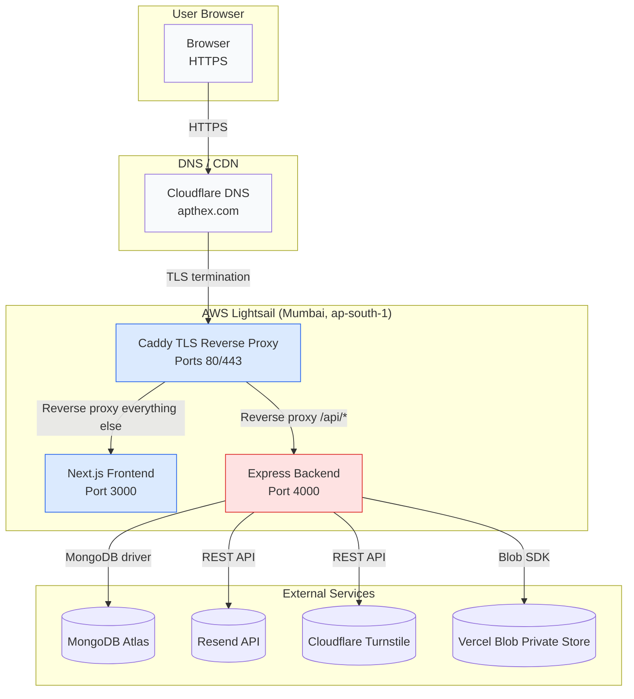

# APTHEX Technologies — Complete System Architecture

**File:** `APTHEX_COMPLETE_SYSTEM_ARCHITECTURE.md`  
**Status:** Single source of truth for the complete APTHEX digital ecosystem  
**Last updated:** Sat Nov 07 2026  
**Source of truth:** Actual source code inspection — no hypothetical features included  

---

## 1. Executive Summary

APTHEX Technologies operates a **two-project digital ecosystem** hosted in a single repository:

| Project | Purpose | Tech Stack | Status |
|---|---|---|---|
| **Public Website** | Marketing site at apthex.com — offensive security services, threat data, partner testimonials, contact/assessment form | Static HTML + Next.js 16.4.5 (inlines content) | Implemented & Verified |
| **Complaint Portal** | Privacy-first complaint reporting at `/help` — public reporting, status tracking, staff Case Desk | Next.js 16.4.5 + Express 5 + MongoDB Atlas | Implemented & Verified (code), Blocked (production credentials) |

**Important:** There is **no separate Internal Management / Operations Portal** in this repository. The Complaint Portal contains its own staff-only Case Desk (`/help/desk/*`) for case management, which serves the internal operations role. The `nextjs-site/` project is purely the public marketing website — it does not contain internal management dashboards for leads, clients, tasks, work logs, meetings, or finance.

---

## 2. Complete Architecture Tree

```
APTHEX TECHNOLOGIES ECOSYSTEM
│
├── PUBLIC WEBSITE (apthex.com)
│   ├── Technology: Static HTML + Next.js 16.4.5
│   ├── Hosting: Not yet deployed (localhost:3000 in development)
│   ├── Sections:
│   │   ├── 01 Home — Hero with threat floating cards, starfield background
│   │   ├── 02 Threats — Live CERT-In ticker, threat statistics (Global/India)
│   │   ├── 03 Services — VAPT, SOC monitoring, Code & cloud review, Advisory & training
│   │   ├── 04 Partners — Glassmorphism partner cards with logos, rotating testimonials
│   │   ├── 05 Team — Three founders (Pranav Patil, Devendra Hyalij, Yukta Geete)
│   │   └── 06 Work/Contact — 3-step process, contact strip (email: contact@apthex.com)
│   ├── Features:
│   │   ├── Assessment request modal (POST to FormSubmit → contact@apthex.com)
│   │   ├── Complaint Portal integration at /help route
│   │   └── Multilingual: English, Hindi, Marathi
│   └── Status: Implemented & Verified (build passes, all 14 routes generated)
│
├── COMPLAINT PORTAL (/help)
│   ├── Technology: Next.js 16.4.5 frontend + Express 5 backend + MongoDB Atlas
│   ├── Hosting: Not yet deployed (localhost:4000 API + localhost:3000 frontend)
│   ├── Public Routes:
│   │   ├── /help — Welcome page (institute code validation)
│   │   ├── /help/category — Category selection (incl. urgent safety concern)
│   │   ├── /help/details — Complaint details, personal info, evidence upload
│   │   ├── /help/thanks — Submission confirmation with reference ID
│   │   ├── /help/status — Public status lookup (In Process / Completed only)
│   │   └── /help/staff/login — Staff sign-in with TOTP 2FA
│   ├── Staff Case Desk Routes (authenticated):
│   │   ├── /help/desk — Dashboard with case list, filters, summary stats
│   │   ├── /help/desk/complaint/[ref] — Individual case detail & management
│   │   ├── /help/desk/stats — Institute statistics & monthly reports
│   │   ├── /help/desk/staff — Staff account management (owner only)
│   │   ├── /help/desk/audit — Security audit log (owner only)
│   │   └── /help/desk/email — Email outbox log (owner only)
│   ├── Backend API (/api/*):
│   │   ├── /api/health — Health check
│   │   ├── /api/config — Public config (languages, CAPTCHA state)
│   │   ├── /api/institutes/validate — Institute code validation
│   │   ├── /api/complaints — Submit, list, view, patch complaints
│   │   ├── /api/status/lookup — Public status lookup
│   │   ├── /api/status/followup — Public follow-up submission
│   │   ├── /api/attachments/:id/url — Signed evidence URL (staff only)
│   │   ├── /api/attachments/download/:id — Local download (staff only)
│   │   ├── /api/auth/* — Login, TOTP setup, logout, session management
│   │   ├── /api/staff/members — Staff CRUD (owner only)
│   │   ├── /api/staff/audit — Audit log (owner only)
│   │   ├── /api/staff/outbox — Email outbox (owner only)
│   │   ├── /api/stats/* — Institute statistics
│   │   └── /api/reports/* — Monthly PDF reports (owner only)
│   └── Status: Implemented (code), Blocked (production credentials required)
│
└── SHARED INFRASTRUCTURE
    ├── MongoDB Atlas — Database: Apethexhelpportal (dedicated, isolated from management Apthexx DB)
    ├── Resend Email — Sender: mail.apthex.com (verified domain required)
    ├── Cloudflare Turnstile — CAPTCHA for complaint submission & follow-up
    ├── Vercel Blob — Private evidence storage (`apthex-complaint-evidence`)
    ├── AWS Lightsail — Ubuntu 24.04 + Caddy TLS reverse proxy (not yet provisioned)
    └── DNS — apthex.com zone (control not yet confirmed)
        ├── apthex.com — Vercel project serving the site and the portal at https://apthex.com/help (final)
        └── mail.apthex.com (Resend DKIM/SPF/DMARC records required)
```

---

## 3. Component Details

### 3.1 Public Website (`nextjs-site/`)

**Architecture:**
- The public website is a **single-page static site** originally written as `index.html` at the repository root.
- It is served through Next.js 16.4.5 (`nextjs-site/`) which inlines the entire `index.html` content via `content.js` (exports `BODY_HTML` and `SCRIPT_JS`).
- The Next.js app has **no backend routes** — it is purely a frontend renderer for the static content.
- The Complaint Portal frontend is mounted at `/help` using Next.js App Router.

**Sections (6 total):**
| Section | ID | Purpose |
|---|---|---|
| Home | `#home` | Hero with threat floating cards, starfield canvas background |
| Threats | `#threats` | Live threat counter, statistics cards (Global/India toggle) |
| Services | `#services` | 4 service groups: Security testing, Monitoring & response, Code & cloud review, Advisory & training |
| Partners | `#partners` | Glassmorphism partner cards (7 partners), rotating testimonials carousel |
| Team | `#team` | 3 founders with LinkedIn links, on-demand scroll |
| Work/Contact | `#work` + `#contact-block` | 3-step process (find, test, fix), contact strip with email/response/assessment |

**External Integration:**
- **FormSubmit** — Assessment form posts to `https://formsubmit.co/ajax/contact@apthex.com` (external service, no signup required). First submission triggers activation email; fallback to `mailto:` if POST fails.

### 3.2 Complaint Portal (`complaint-portal/`)

**Frontend (`client-next/`):**
- Next.js 16.4.5, React 19.3.0, App Router
- All pages are `"use client"` components
- Design system: Custom CSS (no frameworks), dark theme, Space Grotesk font
- Internationalization: English (`en`), Hindi (`hi`), Marathi (`mr`)
- Components: `PublicShell`, `DeskShell`, `Protected`, `Turnstile`, `StepIndicator`, `Icon`, `Spinner`, `LanguageSwitcher`, `StatusBadge`
- API client: `lib/api.js` with CSRF token handling, credentials mode, multipart XHR uploads with progress tracking

**Backend (`server/`):**
- Express 5.0.1, Node.js 24, Mongoose 9.0.0
- Port 4000 by default
- Security: Helmet (CSP disabled — frontend sets its own), CORS with origin checking, rate limiting (600 req/min global), cookie parsing, `Cache-Control: no-store` on all API responses
- Authentication: Password + TOTP 2FA, server-side revocable sessions, CSRF protection
- File storage: Local filesystem (development) or Vercel Blob `apthex-complaint-evidence` (production), private objects, short-lived signed proxy URLs
- Email: Resend with database outbox and retry worker
- Scheduler: `node-cron` — outbox processing (every minute), deletion (daily 02:00), monthly reports (1st 06:00), escalation (daily 08:00)

**Database Models (12 collections):**

| Collection | Purpose | Contains Sensitive Data? |
|---|---|---|
| `institutes` | Verified institute codes and contact info | No (metadata only) |
| `complaints` | Complaint records (no contact for anonymous) | Yes (details_text for identified) |
| `contacts` | Reporter identity (identified only) | Yes (name, roll, mobile, email) |
| `attachments` | Evidence file metadata | No (file content in storage, not DB) |
| `case_events` | Case timeline events | Yes (notes may contain sensitive info) |
| `members` | Staff accounts | Yes (email, password hash) |
| `staff_sessions` | Active sessions | No (token hashes only) |
| `audit_events` | Append-only audit log | No (hashed IP, no complaint content) |
| `rate_limits` | Rate limit counters | No (hashed keys) |
| `stats_monthly` | Aggregate monthly statistics | No (counts only) |
| `deletion_log` | Retention deletion records | No (ref_id + institute only) |
| `email_outbox` | Email delivery queue | Yes (recipient, subject, body) |

---

## 4. Communication Architecture

### 4.1 Frontend → Backend Communication

```
┌─────────────────┐      HTTPS/WSS       ┌─────────────────────┐
│   User Browser  │ ◄───────────────────► │   Next.js Frontend  │
│   (Port 3000)   │      (same origin)    │  (nextjs-site)      │
└─────────────────┘                      └───────────┬──────────┘
                                                     │ API rewrite
                                                     │ /api/* → :4000
                                                     ▼
                                      ┌─────────────────────────┐
                                      │   Express Backend       │
                                      │   (complaint-portal/)   │
                                      │   (Port 4000)           │
                                      └───────────┬─────────────┘
                                                  │
              ┌───────────────────────────────────┼───────────────────────────────────┐
              │                                   │                                   │
              ▼                                   ▼                                   ▼
      ┌───────────────┐                 ┌─────────────────┐                 ┌──────────────┐
      │ MongoDB Atlas │                 │  Vercel Blob    │                 │   Resend     │
      │   (DB)        │◄───────────────►│   (Storage)     │◄───────────────►│   (Email)    │
      └───────────────┘                 └─────────────────┘                 └──────────────┘
                                                  │
                                                  ▼
                                          ┌──────────────┐
                                          │ Cloudflare   │
                                          │   Turnstile  │
                                          │   (CAPTCHA)  │
                                          └──────────────┘
```

### 4.2 Data Flow: Complaint Submission

```
User Browser
     │
     │ 1. Fill form (institute, category, details, contact, evidence, CAPTCHA)
     ▼
Next.js Frontend (/help/details)
     │
     │ 2. Verify CAPTCHA with Cloudflare Turnstile
     ▼
Cloudflare Turnstile API ◄────────────────────── Verify token
     │
     │ 3. Return valid/invalid token
     ▼
Next.js Frontend
     │
     │ 4. POST /api/complaints (multipart form data)
     ▼
Express Backend (Port 4000)
     │
     │ 5a. Validate CAPTCHA token
     │ 5b. Rate limit (IP/device/anonymous)
     │ 5c. Validate institute code
     │ 5d. Process images (sharp: resize, strip EXIF, compress to JPEG)
     │ 5e. Process voice (music-metadata: validate format, check duration)
     │ 5f. Save objects to Blob/local storage
     │ 5g. Create Complaint record (ref_id: APX-YYYY-XXXXXX)
     │ 5h. Create Contact record (identified only)
     │ 5i. Create Attachment records
     │ 5j. Apply stats delta
     │ 5k. Queue email notifications
     ▼
MongoDB Atlas ◄────────────────────── Write complaint, contact, attachments
Express Backend ◄────────────────────── Confirm creation
     │
     │ 6. Blob put() upload (evidence files)
     ▼
Vercel Blob ◄──────────────────────────────── Store evidence privately
     │
     │ 7. Resend API (queue complaint notification)
     ▼
Resend ◄──────────────────────────────────── Send alert to case mailbox
     │
     │ 8. Return 201 + ref_id
     ▼
Next.js Frontend ◄──────────────────────────── Display thank-you page with reference ID
     │
     ▼
User Browser
```

### 4.3 Authentication Flow

```
Staff User
     │
     │ 1. Visit /help/staff/login
     ▼
Next.js Frontend
     │
     │ 2. POST /api/auth/login (email + password)
     ▼
Express Backend
     │
     │ 3. Rate limit check (5 attempts/15 min per IP+email)
     │ 4. bcrypt.compare(password, password_hash)
     │ 5. If TOTP not enrolled: generate setup token, return setupRequired=true
     │ 6. If TOTP enrolled: verify TOTP code (speakeasy, window: 1)
     ▼
Express Backend
     │
     │ 7. createStaffSession(): 32-byte token + 24-byte CSRF token
     │ 8. SHA-256 hash tokens, store in StaffSession collection
     │ 9. Set HttpOnly+SameSite=Lax+Secure cookies
     ▼
Express Backend ◄────────────────────── Return session + CSRF token
     │
     │ 10. Set cookies in browser
     ▼
Next.js Frontend ◄────────────────────── Redirect to /help/desk
     │
     ▼
Staff User (authenticated)
```

---

## 5. Database Relationship Diagram (ER Diagram)

```mermaid
erDiagram
    institutes ||--o{ complaints : "has many"
    complaints ||--o{ contacts : "has one (identified only)"
    complaints ||--o{ attachments : "has many"
    complaints ||--o{ case_events : "has many"
    members ||--o{ staff_sessions : "has many"
    members ||--o{ case_events : "creates (staff actions)"
    members ||--o{ complaints : "assigned_to"
    
    institutes {
        string code PK
        string name
        string type
        string head_email
        string status
        datetime created_at
    }
    
    complaints {
        string ref_id PK
        string institute_code FK
        string category
        string details_text
        string details_hash
        boolean urgent
        string mode
        string class_label
        string status
        boolean flagged_spam
        boolean escalated
        string assigned_to FK
        datetime created_at
        datetime completed_at
        datetime delete_after
    }
    
    contacts {
        string complaint_id PK FK
        string kind
        string name
        string roll_no
        string mobile
        string email
        datetime created_at
    }
    
    attachments {
        string _id PK
        string complaint_id FK
        string type
        string storage_key
        string mime
        number size_bytes
        datetime created_at
    }
    
    case_events {
        string _id PK
        string complaint_id FK
        string member_id FK
        string event
        string note
        datetime occurred_at
    }
    
    members {
        string _id PK
        string email UK
        string password_hash
        string role
        string status
        string totp_secret
        boolean totp_enabled
        number failed_login_count
        datetime locked_until
        datetime last_login_at
        datetime created_at
    }
    
    staff_sessions {
        string _id PK
        string token_hash UK
        string member_id FK
        string csrf_hash
        datetime created_at
        datetime last_seen_at
        datetime expires_at
        datetime revoked_at
    }
    
    audit_events {
        string _id PK
        datetime occurred_at
        string member_id FK
        string action
        string entity
        string entity_id
        string outcome
        string ip
        string detail
    }
    
    email_outbox {
        string _id PK
        string dedupe_key UK
        string to
        string subject
        string html
        string text
        string kind
        mixed meta
        string status
        number attempts
        datetime next_attempt_at
        datetime locked_at
        string last_error
        string provider_message_id
        datetime created_at
        datetime sent_at
        datetime expires_at
    }
```

---

## 6. API Communication Flow

All API communication flows through the Express backend at port 4000. The Next.js frontend proxies `/api/*` and `/help/api/*` to the backend via `next.config.mjs` rewrites.

### 6.1 Public API Endpoints (No Authentication Required)

| Method | Endpoint | Purpose | Auth | Database | External |
|---|---|---|---|---|---|
| GET | `/api/health` | Health check | No | MongoDB (connection check) | No |
| GET | `/api/config` | Public config (languages, CAPTCHA) | No | No | No |
| GET | `/api/institutes/validate` | Validate institute code | No | MongoDB (institutes) | No |
| POST | `/api/complaints` | Submit complaint | No (CAPTCHA) | MongoDB (complaints, contacts, attachments) | Vercel Blob, Resend, Turnstile |
| POST | `/api/status/lookup` | Check complaint status | No | MongoDB (complaints, deletion_log) | No |
| POST | `/api/status/followup` | Submit follow-up | No (CAPTCHA) | MongoDB (complaints, case_events) | No |

### 6.2 Staff API Endpoints (Authentication Required)

| Method | Endpoint | Purpose | Auth | Role |
|---|---|---|---|---|
| POST | `/api/auth/login` | Staff sign-in | No (rate-limited) | All |
| POST | `/api/auth/setup-2fa` | TOTP enrolment | No (rate-limited) | All |
| POST | `/api/auth/logout` | Sign out | Yes + CSRF | All |
| GET | `/api/auth/me` | Session info | Yes | All |
| GET | `/api/auth/sessions` | List sessions | Yes | All |
| POST | `/api/auth/sessions/:id/revoke` | Revoke session | Yes + CSRF | All |
| POST | `/api/auth/sessions/revoke-others` | Revoke other sessions | Yes + CSRF | All |
| GET | `/api/complaints` | Case list + filters | Yes | All |
| GET | `/api/complaints/:ref_id` | Case detail | Yes | All |
| PATCH | `/api/complaints/:ref_id` | Update case | Yes + CSRF | All |
| GET | `/api/attachments/:id/url` | Signed evidence URL | Yes | All |
| GET | `/api/attachments/download/:id` | Download evidence | Yes (signature) | All |
| GET | `/api/staff/assignable` | Assignable staff list | Yes | All |
| GET | `/api/staff/members` | Staff list | Yes + CSRF | Owner only |
| POST | `/api/staff/members` | Create staff | Yes + CSRF | Owner only |
| PATCH | `/api/staff/members/:id` | Update staff | Yes + CSRF | Owner only |
| POST | `/api/staff/members/:id/reset-password` | Reset password | Yes + CSRF | Owner only |
| POST | `/api/staff/members/:id/revoke-sessions` | Revoke sessions | Yes + CSRF | Owner only |
| GET | `/api/staff/audit` | Audit log | Yes + CSRF | Owner only |
| GET | `/api/staff/outbox` | Email outbox | Yes + CSRF | Owner only |
| POST | `/api/staff/outbox/process` | Process outbox | Yes + CSRF | Owner only |
| GET | `/api/stats/institutes` | Institute list | Yes | All |
| GET | `/api/stats/institute/:code` | Institute stats | Yes | All |
| GET | `/api/stats/monthly` | Monthly stats | Yes | All |
| GET | `/api/stats/overview` | Overview stats | Yes | All |
| GET | `/api/reports/preview` | PDF preview | Yes | All |
| GET | `/api/reports/data` | Report data | Yes | All |
| POST | `/api/reports/send` | Send report | Yes + CSRF | Owner only |

---

## 7. Authentication & Role-Permission Flow

```mermaid
graph TD
    classDef owner fill:#dc2626,color:#fff,stroke:#b91c1c
    classDef caseTeam fill:#2563eb,color:#fff,stroke:#1d4ed8
    classDef public fill:#6b7280,color:#fff,stroke:#4b5563

    U[Public User]:::public
    U -->|No credentials| P[Public Portal /help]
    P -->|Submit complaint| CS[Case Created<br/>ref_id APX-YYYY-XXXXXX]
    P -->|Check status| SS[Status Lookup<br/>In Process / Completed]
    P -->|Send follow-up| SF[Follow-up Submission]
    
    S[Staff User]:::caseTeam
    S -->|1. Email + Password| LG[/api/auth/login]
    LG -->|Rate limit: 5/15min| RL[Rate Limit Check]
    RL -->|Blocked| LB[Lockout 15 min]
    RL -->|Allowed| BC[bcrypt.compare password]
    BC -->|Invalid| IA[Invalid credentials]
    BC -->|Valid| TOTP{2FA Enrolled?}
    TOTP -->|No| SET[Generate setup token<br/>10-min expiry]
    TOTP -->|Yes| VER[Verify TOTP code<br/>speakeasy window:1]
    SET -->|User scans QR| ENR[Enrol TOTP<br/>Save encrypted secret]
    ENR --> SESS[Create session<br/>32-byte token + CSRF]
    VER -->|Valid| SESS
    VER -->|Invalid| IV[Invalid code]
    SESS -->|HttpOnly cookie| CSD[Case Desk /help/desk]
    
    O[Owner User]:::owner
    O -->|Same login flow| LG2[/api/auth/login]
    LG2 --> SESS2[Session + CSRF]
    SESS2 --> CSD
    
    CSD -->|View cases| CD[Complaint Dashboard]
    CSD -->|Open case| CDD[Complaint Detail]
    CDD -->|Complete/Reopen| COMP[Status change + retention timer]
    CDD -->|Add note| NOTE[Internal note + audit]
    CDD -->|Flag spam| SPAM[Flag/unflag + stats delta]
    CDD -->|Assign| ASG[Assign to staff member]
    
    CSD -->|Owner only| SM[Staff Management<br/>Create/Deactivate/Reset/Revoke]
    CSD -->|Owner only| AL[Audit Log<br/>Append-only, hashed IP]
    CSD -->|Owner only| EO[Email Outbox<br/>Queue/Process/Send]
    CSD -->|Owner only| MR[Monthly Reports<br/>PDF generation + email]
    
    style U fill:#f3f4f6,stroke:#9ca3af
    style S fill:#dbeafe,stroke:#2563eb
    style O fill:#fee2e2,stroke:#dc2626
```

---

## 8. External Services Integration Diagram

```mermaid
graph TB
    classDef implemented fill:#10b981,color:#fff
    classDef blocked fill:#ef4444,color:#fff
    classDef planned fill:#f59e0b,color:#fff

    subgraph APTHEX ECOSYSTEM
        FE[Next.js Frontend<br/>Port 3000]
        BE[Express Backend<br/>Port 4000]
    end

    subgraph EXTERNAL SERVICES
        MA[MongoDB Atlas<br/>Apethexhelpportal DB]:::implemented
        RS[Resend Email<br/>mail.apthex.com]:::blocked
        CT[Cloudflare Turnstile<br/>CAPTCHA verification]:::blocked
        VB[Vercel Blob<br/>apthex-complaint-evidence Private Store]:::blocked
        LS[AWS Lightsail<br/>Ubuntu 24.04 + Caddy]:::blocked
        DNS[DNS Zone<br/>apthex.com]:::planned
        FS[FormSubmit<br/>contact@apthex.com]:::implemented
    end

    FE -->|API rewrite /api/*| BE
    BE -->|Read/Write| MA
    BE -->|Queue/Send email| RS
    BE -->|Verify CAPTCHA| CT
    BE -->|Store/Retrieve evidence| VB
    BE -->|Hosted on| LS
    DNS -->|A record + DKIM/SPF| RS
    DNS -->|A record| LS
    FE -->|Assessment form POST| FS

    linkStyle default stroke:#94a3b8,stroke-width:2px
```

### External Service Status Summary

| Service | Purpose | Status | Required For Production |
|---|---|---|---|
| **MongoDB Atlas** | Primary database | Connected (dev) | Atlas Network Access: add Lightsail IP |
| **Resend** | Email delivery | API key present, domain unverified | Verify `mail.apthex.com`, DNS records |
| **Cloudflare Turnstile** | CAPTCHA | Keys not configured | Create Turnstile site, add keys |
| **Vercel Blob** | Evidence storage | Adapter implemented, driver=local | Create private store, read/write token, set STORAGE_DRIVER=vercel-blob |
| **AWS Lightsail** | Hosting | Not provisioned | Provision Ubuntu 24.04 in Mumbai |
| **DNS** | Domain resolution | Not confirmed | Confirm athex.com zone control, add records |
| **FormSubmit** | Assessment form lead delivery | Implemented & working | None (external service) |

---

## 9. Deployment & Infrastructure Architecture



### Deployment Readiness

| Component | Status | Blocker |
|---|---|---|
| Next.js build | ✅ Verified (all 14 routes generated) | None |
| Express server | ✅ Starts locally with MongoDB | None |
| Production config guard | ✅ Implemented (`assertProductionConfig()`) | Will reject startup until all prod values set |
| Real Resend delivery | ❌ Not tested | Requires verified `mail.apthex.com` domain |
| Real Vercel Blob store | ❌ Not tested | Requires `BLOB_READ_WRITE_TOKEN` token |
| Real Turnstile | ❌ Not tested | Requires site key + secret key |
| HTTPS/TLS | ❌ Not deployed | Requires Lightsail instance + Caddy |
| Penetration test | ❌ Not commissioned | Requires owner approval |
| WCAG 2.2 AA audit | ❌ Not commissioned | Requires owner approval |

---

## 10. Data Flow Diagrams for Important Operations

### 10.1 Complaint Submission (Complete Flow)

```
┌─────────────────────────────────────────────────────────────────────────────┐
│  STEP 1: User submits complaint form                                        │
│  └─ Frontend collects: institute_code, category, details_text, contact,    │
│      evidence (images/voice), captchaToken, deviceId                        │
└─────────────────────────────────────────────────────────────────────────────┘
                              │
                              ▼
┌─────────────────────────────────────────────────────────────────────────────┐
│  STEP 2: Frontend validates CAPTCHA                                         │
│  └─ POST to Cloudflare Turnstile verify endpoint                            │
│  └─ Returns valid/invalid token                                             │
└─────────────────────────────────────────────────────────────────────────────┘
                              │
                              ▼
┌─────────────────────────────────────────────────────────────────────────────┐
│  STEP 3: Frontend POSTs /api/complaints (multipart)                         │
│  └─ Backend validates: CAPTCHA, rate limits, institute code,                │
│      duplicate detection, file types/sizes                                  │
│  └─ Processes images (sharp: EXIF removal, resize, compress)               │
│  └─ Processes voice (music-metadata: format validation, duration check)    │
└─────────────────────────────────────────────────────────────────────────────┘
                              │
                              ▼
┌─────────────────────────────────────────────────────────────────────────────┐
│  STEP 4: Backend stores data                                                │
│  └─ Save evidence to Blob/local storage                                     │
│  └─ Create Complaint record (ref_id: APX-YYYY-XXXXXX)                       │
│  └─ Create Contact record (identified only)                                 │
│  └─ Create Attachment records                                               │
│  └─ Apply stats delta                                                       │
│  └─ Audit log: complaint_created                                            │
└─────────────────────────────────────────────────────────────────────────────┘
                              │
                              ▼
┌─────────────────────────────────────────────────────────────────────────────┐
│  STEP 5: Backend queues notifications                                       │
│  └─ queueComplaintNotifications()                                           │
│     ├── newComplaintTemplate → APTHEX_CASE_MAILBOX                          │
│     ├── urgentTemplate → Case mailbox + URGENT_ALERT_RECIPIENTS (if urgent)│
│     └── reporterConfirmationTemplate → Reporter email (identified only)    │
│  └─ processOutbox() with priority limit (urgent: 10, normal: 3)            │
└─────────────────────────────────────────────────────────────────────────────┘
                              │
                              ▼
┌─────────────────────────────────────────────────────────────────────────────┐
│  STEP 6: Frontend displays thank-you page                                   │
│  └─ Shows reference ID, acknowledgement email status                        │
│  └─ Options: Check status, Report another concern                           │
└─────────────────────────────────────────────────────────────────────────────┘
```

### 10.2 Staff Case Management Flow

```
┌─────────────────────────────────────────────────────────────────────────────┐
│  STEP 1: Staff authenticates                                                │
│  └─ Login with email + password + TOTP                                      │
│  └─ Session created (HttpOnly cookie + CSRF token)                          │
└─────────────────────────────────────────────────────────────────────────────┘
                              │
                              ▼
┌─────────────────────────────────────────────────────────────────────────────┐
│  STEP 2: Staff views case dashboard                                         │
│  └─ GET /api/complaints with filters (institute, category, status, etc.)   │
│  └─ View summary stats (total, urgent, in_process, completed)               │
└─────────────────────────────────────────────────────────────────────────────┘
                              │
                              ▼
┌─────────────────────────────────────────────────────────────────────────────┐
│  STEP 3: Staff opens complaint detail                                       │
│  └─ GET /api/complaints/:ref_id                                             │
│  └─ View: case summary, reporter details (identified only), evidence,      │
│       timeline, assignment, status                                          │
└─────────────────────────────────────────────────────────────────────────────┘
                              │
                              ▼
┌─────────────────────────────────────────────────────────────────────────────┐
│  STEP 4: Staff takes action (PATCH /api/complaints/:ref_id + CSRF)          │
│  └─ Mark complete/reopen → status change + retention timer                  │
│  └─ Add internal note → CaseEvent + audit                                   │
│  └─ Flag/unflag spam → stats delta + audit                                  │
│  └─ Assign to staff → assignment update + audit                             │
└─────────────────────────────────────────────────────────────────────────────┘
                              │
                              ▼
┌─────────────────────────────────────────────────────────────────────────────┐
│  STEP 5: Retention deletion (scheduler, daily 02:00 Mumbai)                 │
│  └─ Find complaints where delete_after <= now                               │
│  └─ Delete complaint, attachments (storage + DB), contact, case_events     │
│  └─ Create DeletionLog record                                               │
│  └─ Audit log: retention_deletion                                           │
└─────────────────────────────────────────────────────────────────────────────┘
```

---

## 11. Status Summary

### 10.1 Implementation Status by Component

| Component | Status | Evidence |
|---|---|---|
| Public website (6 sections) | ✅ Implemented & Verified | `index.html` + `content.js`, Next.js build passes |
| Complaint Portal public routes | ✅ Implemented & Verified | 7 routes, all tested |
| Complaint Portal staff routes | ✅ Implemented & Verified | 7 routes, all tested |
| Express backend API | ✅ Implemented & Verified | 10 route modules, 31 tests (30 pass) |
| MongoDB Atlas connection | ✅ Connected (dev) | Health endpoint returns connected |
| Vercel Blob storage adapter | ✅ Implemented (code complete) | Not connected (driver=local) |
| Resend email integration | ✅ Implemented (code complete) | Not tested (invalid API key) |
| Cloudflare Turnstile | ✅ Implemented (dev bypass) | Not tested (no production keys) |
| AWS Lightsail hosting | ❌ Not provisioned | No instance created |
| DNS configuration | ❌ Not configured | Zone control not confirmed |
| Production config guard | ✅ Implemented | Will block startup until all prod values set |

### 10.2 Known Gaps

1. **No Internal Management Portal exists** — The repository does not contain a separate internal management/operations portal. The Complaint Portal's Case Desk serves the staff operations role.
2. ~~**URL conflict** — `OPEN_DECISIONS.md` specifies `https://complaints.apthex.com` (subdomain), but the `/help` integration task specifies `https://apthex.com/help` (path). Owner must confirm.~~ **Resolved (Nov 2026):** final URLs are `https://apthex.com/help` (portal) and `https://apthex.com/help/desk` (Case Desk); browser origin `https://apthex.com`.
3. **Production credentials missing** — Resend domain verification, Turnstile keys, Vercel Blob read/write token, Lightsail instance all require external provisioning.
4. **No penetration test or WCAG audit** — Required before launch per `OPEN_DECISIONS.md`.
5. **Demo data present** — `SCHOOL01`/`COLLEGE01` institutes and `owner@apthex.local` owner account must be removed before production.

---

## 11. Change History

| Date | What Changed | Files/Modules Affected | Reason | Tests Performed | Result |
|---|---|---|---|---|---|
| Sat Nov 07 2026 | Initial architecture documentation created | `APTHEX_COMPLETE_SYSTEM_ARCHITECTURE.md` (new) | Consolidate complete ecosystem view | Full codebase inspection: all routes, models, services, configs, tests | N/A (documentation only) |

---

## 12. Continuous Maintenance Rules

This document must be updated whenever any project, route, API, database model, integration, or workflow changes:

1. Update the relevant section of this document.
2. Update the architecture tree (Section 2) if projects are added/removed.
3. Update the API documentation (Section 6) when endpoints change.
4. Update the ER diagram (Section 5) when schemas or indexes change.
5. Update external services status (Section 8) when integrations are connected.
6. Update deployment status (Section 9) when infrastructure is provisioned.
7. Add an entry to the change history (Section 11) — never overwrite previous entries.
8. Keep the implementation status table (Section 10.1) synchronized with actual test results.

**Rules:**
- Use actual code and configuration as the source of truth.
- Do not invent functionality, endpoints, or integrations.
- Distinguish implemented, connected, verified, planned, and not implemented.
- Never include secrets or personal complaint data.
