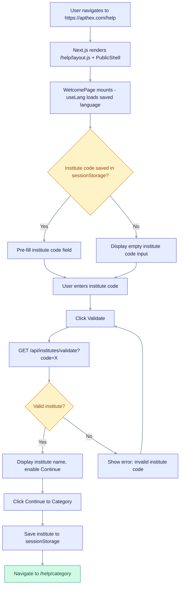
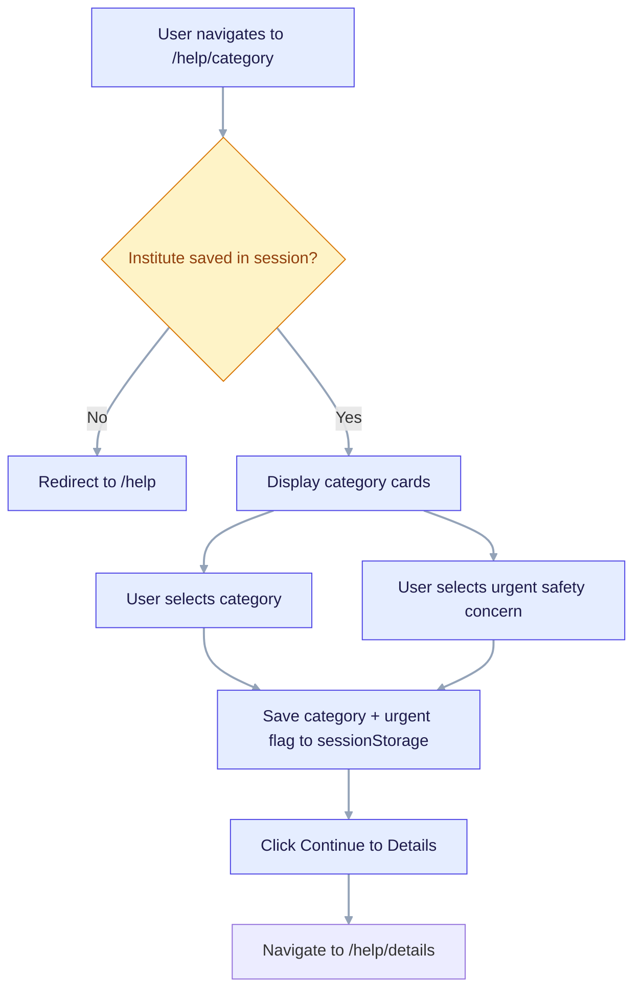
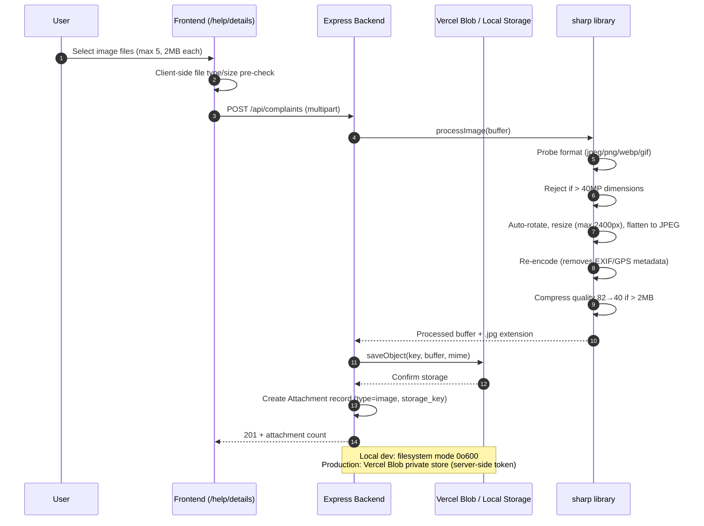
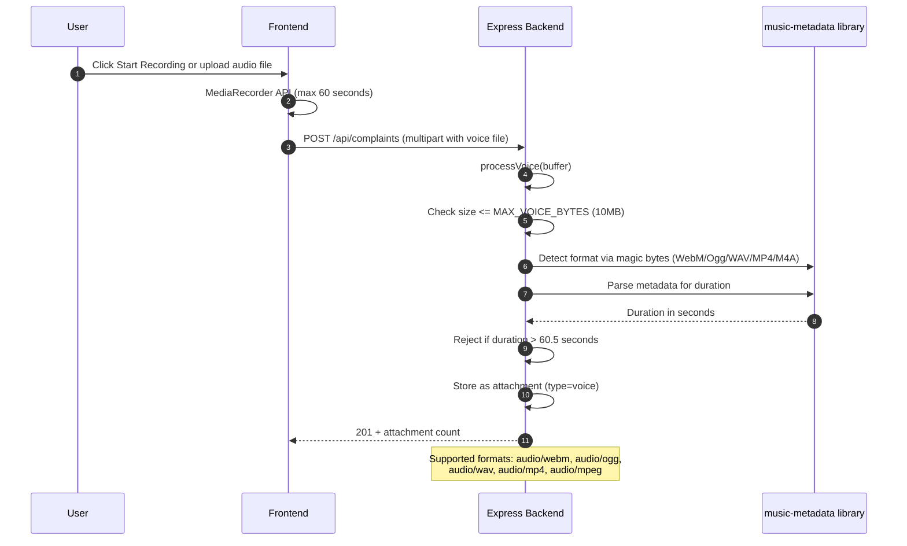
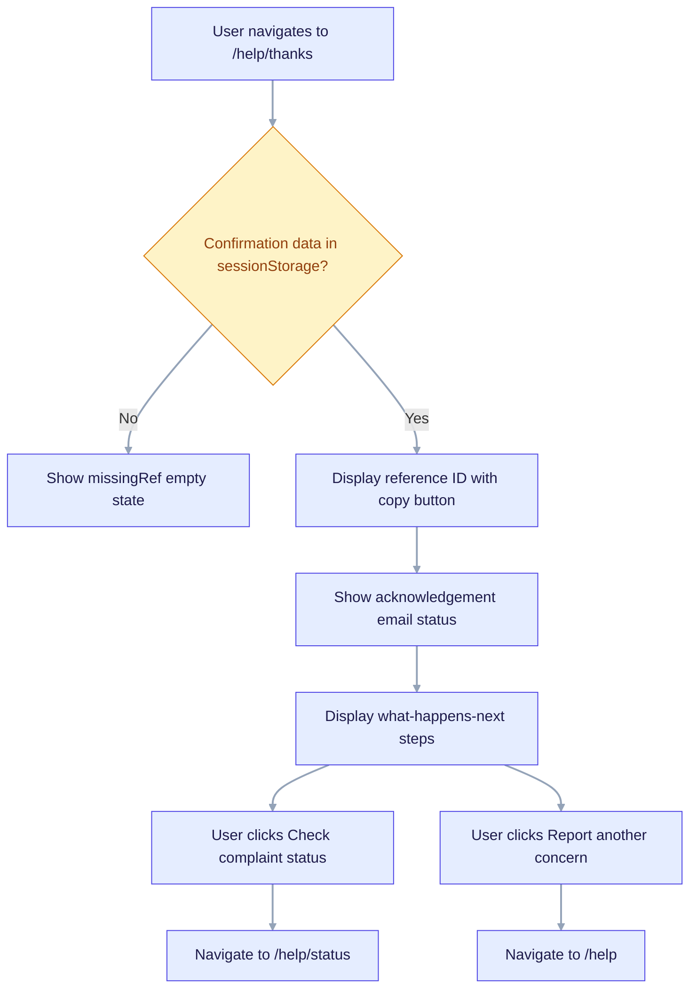
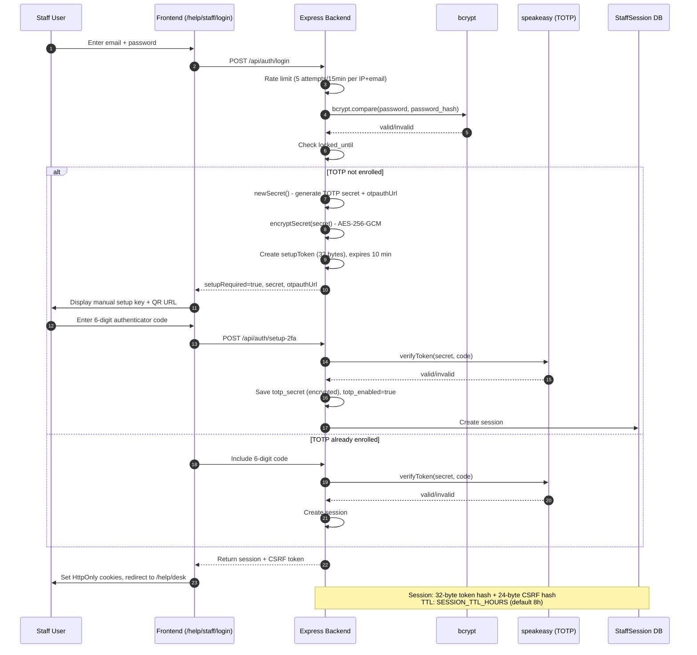

# APTHEX Technologies — Workflow Diagrams

**File:** `APTHEX_WORKFLOW_DIAGRAMS.md`  
**Status:** Complete user journey and navigation flow documentation  
**Last updated:** Sat Nov 07 2026  
**Source of truth:** Actual source code inspection  

---

## 1. Overview

This document contains Mermaid flowcharts and sequence diagrams for every user flow in the APTHEX ecosystem. All flows are derived from actual source code — no hypothetical functionality is included.

**Flows covered:**
1. Public visitor opening `/help`
2. Institute code validation
3. Language selection (English, Hindi, Marathi)
4. Complaint category selection
5. Identified complaint submission
6. Anonymous complaint submission
7. Personal information collection
8. Evidence image upload
9. Voice recording and upload
10. CAPTCHA validation
11. Complaint submission and reference ID generation
12. Thank-you page
13. Complaint status checking
14. Follow-up submission
15. Urgent complaint flow
16. Staff login and TOTP authentication
17. Case Desk complaint management
18. Case completion and reopening
19. Internal notes and spam management
20. Institute monthly reports
21. Data retention and automatic deletion
22. Assessment request (marketing site)

---

## 2. Public Complaint Portal Flows

### 2.1 Public Visitor Opening `/help`



### 2.2 Language Selection

```mermaid
flowchart TD
    classDef step fill:#e5edff,stroke:#4f46e5,color:#1e1b4b

    A[LanguageSwitcher component renders]:::step
    B[User clicks language button (en/hi/mr)]:::step
    C[setLang(languageCode) called]:::step
    D[useLang hook saves to localStorage]:::step
    E[document.documentElement.lang updated]:::step
    F[All t() translations re-render in new language]:::step
    G[Speech synthesis uses language-specific code]:::step

    A --> B
    B --> C
    C --> D
    D --> E
    E --> F
    F --> G

    linkStyle default stroke:#94a3b8,stroke-width:2px
```

**Languages supported:**
| Code | Label | Speech Code |
|---|---|---|
| `en` | English | `en-IN` |
| `hi` | हिन्दी | `hi-IN` |
| `mr` | मराठी | `mr-IN` |

---

### 2.3 Complaint Category Selection



**Categories:**
| Key | Label | Description |
|---|---|---|
| `categoryBlackmail` | Blackmail and Sextortion | Threats to share private photos/conversations |
| `categoryHarassment` | Online Harassment or Bullying | Insulting messages, threats, group harassment |
| `categoryFinancial` | Financial Fraud or Threats | Payment fraud, fake investments, money threats |
| `categoryFake` | Fake Profiles or Account Hacking | Impersonation, fake social media, hacked accounts |
| `categoryInstitution` | Institution-level Issue | Ragging, sexual harassment, campus safety |
| `URGENT_CATEGORY` | Urgent safety concern | Immediate attention required, case team alerted |

---

### 2.4 Identified Complaint Submission

```mermaid
flowchart TD
    classDef step fill:#e5edff,stroke:#4f46e5,color:#1e1b4b
    classDef decision fill:#fef3c7,stroke:#d97706,color:#92400e

    A[User navigates to /help/details]:::step
    B{Institute + category saved?}:::decision
    C[Redirect to / or /help/category]:::step
    D[Load saved institute + category]:::step
    E[Mode defaults to identified]:::step
    F[Fill personal info: name, class, roll, mobile, email]:::step
    G[Enter complaint description (10-5000 chars)]:::step
    H[Optional: upload images (max 5, 2MB each)]:::step
    I[Optional: record/upload voice (max 60s)]:::step
    J[Complete CAPTCHA]:::step
    K[Click Review complaint]:::step
    L[Client-side validation]:::step
    M{Validation passed?}:::decision
    N[Show error: fix highlighted fields]:::step
    O[Display review screen with all data]:::step
    P[Click Submit complaint]:::step
    Q[submitComplaint() multipart POST]:::step
    R[Backend: validate, rate limit, CAPTCHA, process files]:::step
    S[Create Complaint + Contact + Attachments]:::step
    T[Generate ref_id: APX-YYYY-XXXXXX]:::step
    U[Queue email notifications]:::step
    V[Save confirmation to sessionStorage]:::step
    W[Navigate to /help/thanks]:::terminal

    A --> B
    B -->|No| C
    B -->|Yes| D
    D --> E
    E --> F
    F --> G
    G --> H
    H --> I
    I --> J
    J --> K
    K --> L
    L --> M
    M -->|No| N
    N --> L
    M -->|Yes| O
    O --> P
    P --> Q
    Q --> R
    R --> S
    S --> T
    T --> U
    U --> V
    V --> W

    linkStyle default stroke:#94a3b8,stroke-width:2px
```

---

### 2.5 Anonymous Complaint Submission

```mermaid
flowchart TD
    classDef step fill:#e5edff,stroke:#4f46e5,color:#1e1b4b
    classDef decision fill:#fef3c7,stroke:#d97706,color:#92400e

    A[User clicks "Prefer to stay anonymous?"]:::step
    B[Switch mode to anonymous]:::step
    C[Hide personal info fields]:::step
    D[Fill complaint description]:::step
    E[Optional: upload evidence]:::step
    F[Complete CAPTCHA]:::step
    G[Click Submit complaint]:::step
    H[Zod superRefine: reject any identity fields]:::step
    I{Identity fields present?}:::decision
    J[Return 400: personal info not accepted]:::step
    K[Create complaint with mode=anonymous]:::step
    L[NO Contact document created]:::step
    M[complaint.class_label = undefined]:::step
    N[No confirmation email sent]:::step
    O[Generate ref_id + show thank-you]:::step
    P[User advised to save reference ID]:::terminal

    A --> B
    B --> C
    C --> D
    D --> E
    E --> F
    F --> G
    G --> H
    H --> I
    I -->|Yes| J
    I -->|No| K
    K --> L
    K --> M
    K --> N
    K --> O
    O --> P

    linkStyle default stroke:#94a3b8,stroke-width:2px
```

---

### 2.6 Evidence Upload (Images)



---

### 2.7 Voice Recording and Upload



---

### 2.8 CAPTCHA Validation

```mermaid
flowchart TD
    classDef step fill:#e5edff,stroke:#4f46e5,color:#1e1b4b
    classDef decision fill:#fef3c7,stroke:#d97706,color:#92400e

    A[Turnstile widget renders]:::step
    B{Production mode?}:::decision
    C[CAPTCHA_DEV_BYPASS=true + no secret key]:::step
    D[Auto-token: "dev-bypass", status=dev]:::step
    E[Real Turnstile challenge]:::step
    F[User completes challenge]:::step
    G[POST to challenges.cloudflare.com/turnstile/v0/siteverify]:::step
    H{Provider returns success?}:::decision
    I[Return ok=true]:::step
    J[Return ok=false, captchaFailed=true]:::step

    A --> B
    B -->|No| C
    B -->|Yes| E
    C --> D
    E --> F
    F --> G
    G --> H
    H -->|Yes| I
    H -->|No| J

    linkStyle default stroke:#94a3b8,stroke-width:2px
```

---

### 2.9 Complaint Submission and Reference ID Generation

```mermaid
flowchart TD
    classDef step fill:#e5edff,stroke:#4f46e5,color:#1e1b4b

    A[Backend receives multipart POST /api/complaints]:::step
    B[Parse body: institute_code, category, details_text, contact, etc.]:::step
    C[Zod submissionSchema validation]:::step
    D[Verify institute code against active institutes]:::step
    E[Rate limits: IP/device/anonymous per hour]:::step
    F[Duplicate detection: SHA-256(institute_code|details_text)]:::step
    G[Process images via sharp]:::step
    H[Process voice via music-metadata]:::step
    I[generateRefId(now): APX-YYYY-XXXXXX]:::step
    J[Retry up to 8 times on MongoDB 11000 collision]:::step
    K[Create Complaint record]:::step
    L[Create Contact record (identified only)]:::step
    M[Create Attachment records]:::step
    N[Apply stats delta]:::step
    O[Audit log: complaint_created]:::step
    P[Return 201: {ref_id, acknowledgement_email, attachments}]:::terminal

    A --> B
    B --> C
    C --> D
    D --> E
    E --> F
    F --> G
    G --> H
    H --> I
    I --> J
    J --> K
    K --> L
    L --> M
    M --> N
    N --> O
    O --> P

    linkStyle default stroke:#94a3b8,stroke-width:2px
```

**Reference ID format:** `APX-2611-JGG623` (APX + 4-digit year-month + 6-char suffix excluding ambiguous characters 0,1,I,L,O,U)

---

### 2.10 Thank-You Page



---

### 2.11 Complaint Status Checking

```mermaid
flowchart TD
    classDef step fill:#e5edff,stroke:#4f46e5,color:#1e1b4b
    classDef decision fill:#fef3c7,stroke:#d97706,color:#92400e
    classDef terminal fill:#d1fae5,stroke:#059669,color:#064e3b

    A[User navigates to /help/status]:::step
    B[Enter reference ID: APX-YYYY-XXXXXX]:::step
    C{Valid format?}:::decision
    D[Show error: invalid reference ID]:::step
    E[POST /api/status/lookup]:::step
    F[Rate limit: 10 requests/minute per IP]:::step
    G[purgeIfDue(refId) - retention safety net]:::step
    H[Complaint.findOne({ref_id}).select("status")]:::step
    I{Complaint found?}:::decision
    J[Return status: In Process / Completed]:::step
    K[Check DeletionLog for ref_id]:::step
    L[Deletion log found?]:::decision
    M[Return: Completed, data_deleted=true]:::step
    N[Return 404: not found]:::terminal
    O[Display result to user]:::step
    P[Optional: submit follow-up]:::step

    A --> B
    B --> C
    C -->|No| D
    C -->|Yes| E
    E --> F
    F --> G
    G --> H
    H --> I
    I -->|No| K
    I -->|Yes| J
    K --> L
    L -->|Yes| M
    L -->|No| N
    J --> O
    M --> O
    N --> N
    O --> P

    linkStyle default stroke:#94a3b8,stroke-width:2px
```

**Status endpoint returns ONLY:**
- `status`: `In Process` or `Completed`
- No complaint details, contact info, or evidence ever exposed

---

### 2.12 Follow-up Submission

```mermaid
flowchart TD
    classDef step fill:#e5edff,stroke:#4f46e5,color:#1e1b4b
    classDef decision fill:#fef3c7,stroke:#d97706,color:#92400e

    A[User on status page after successful lookup]:::step
    B[Enter follow-up text (min 5 chars)]:::step
    C{CAPTCHA required?}:::decision
    D[Complete Turnstile challenge]:::step
    E[POST /api/status/followup]:::step
    F[Rate limits: IP/hour, ref/hour, device/hour]:::step
    G[purgeIfDue(refId)]:::step
    H[Complaint.findOne({ref_id}).select("_id, ref_id")]:::step
    I{Complaint exists?}:::decision
    J[Create CaseEvent: reporter_followup]:::step
    K[Audit log: reporter_followup]:::step
    L[Return 201: follow-up submitted]:::step

    A --> B
    B --> C
    C -->|Yes| D
    C -->|No| E
    D --> E
    E --> F
    F --> G
    G --> H
    H --> I
    I -->|No| N[Return 404/410]
    I -->|Yes| J
    J --> K
    K --> L

    linkStyle default stroke:#94a3b8,stroke-width:2px
```

---

### 2.13 Urgent Complaint Flow

```mermaid
flowchart TD
    classDef step fill:#e5edff,stroke:#4f46e5,color:#1e1b4b
    classDef urgent fill:#fee2e2,stroke:#dc2626,color:#991b1b

    A[User selects "Urgent safety concern"]:::step
    B[complaint.urgent = true]:::step
    C[category = "Urgent safety concern"]:::step
    D[Submit complaint normally]:::step
    E[queueComplaintNotifications()]:::step
    F[newComplaintTemplate (kind=urgent) → APTHEX_CASE_MAILBOX]:::urgent
    G[urgentTemplate → Case mailbox + URGENT_ALERT_RECIPIENTS]:::urgent
    H[processOutbox() with limit=10 (priority)]:::urgent
    I[Case appears on dashboard with Urgent badge]:::step
    J[Escalation job (daily 08:00): cases open > ESCALATION_DAYS]:::step
    K[escalationTemplate → Case mailbox + urgent recipients]:::urgent

    A --> B
    B --> C
    C --> D
    D --> E
    E --> F
    E --> G
    F --> H
    G --> H
    H --> I
    I --> J
    J --> K

    linkStyle default stroke:#94a3b8,stroke-width:2px
```

---

### 2.14 Staff Login and TOTP Authentication



---

### 2.15 Case Desk Complaint Management

```mermaid
flowchart TD
    classDef step fill:#e5edff,stroke:#4f46e5,color:#1e1b4b
    classDef decision fill:#fef3c7,stroke:#d97706,color:#92400e
    classDef owner fill:#fee2e2,stroke:#dc2626,color:#991b1b

    A[Staff navigates to /help/desk]:::step
    B{Authenticated?}:::decision
    C[Redirect to /help/staff/login]:::step
    D[Display dashboard: stats, filters, case list]:::step
    E[Apply filters: institute, category, status, search]:::step
    F[Click case row]:::step
    G[Navigate to /help/desk/complaint/[ref]]:::step
    H[Display case detail: summary, contact, evidence, timeline]:::step
    L{Owner?}:::decision
    M[Staff Management: create/deactivate/reset/revoke]:::owner
    N[Audit Log: view all privileged actions]:::owner
    O[Email Outbox: queue/process/send]:::owner
    P[Monthly Reports: preview/send PDF]:::owner
    Q[Mark complete/reopen]:::step
    R[Add internal note]:::step
    S[Flag/unflag spam]:::step
    T[Assign to staff member]:::step
    U[Open evidence via signed URL]:::step
    V[All actions require CSRF token + audit log]:::step

    A --> B
    B -->|No| C
    B -->|Yes| D
    D --> E
    E --> F
    F --> G
    G --> H
    H --> L
    L -->|Yes| M
    L -->|Yes| N
    L -->|Yes| O
    L -->|Yes| P
    H --> Q
    H --> R
    H --> S
    H --> T
    H --> U
    Q --> V
    R --> V
    S --> V
    T --> V
    U --> V
    M --> V
    N --> V
    O --> V
    P --> V

    linkStyle default stroke:#94a3b8,stroke-width:2px
```

---

### 2.16 Case Completion and Reopening

```mermaid
flowchart TD
    classDef step fill:#e5edff,stroke:#4f46e5,color:#1e1b4b
    classDef decision fill:#fef3c7,stroke:#d97706,color:#92400e

    A[Staff clicks Mark complete]:::step
    B[PATCH /api/complaints/:ref_id + CSRF]:::step
    C[{completed: true}]:::step
    D[Complaint.findOneAndUpdate: status=completed]:::step
    E[Set completed_at = now]:::step
    F[Set delete_after = now + RETENTION_DAYS]:::step
    G[Apply stats delta: completed +1]:::step
    H[Create CaseEvent: completed]:::step
    I[Audit log: complaint_completed]:::step
    J[Case status = Completed]:::step

    A --> B
    B --> C
    C --> D
    D --> E
    E --> F
    F --> G
    G --> H
    H --> I
    I --> J

    subgraph Reopen
    A2[Staff clicks Reopen]:::step
    B2[PATCH /api/complaints/:ref_id + CSRF]:::step
    C2[{completed: false}]:::step
    D2[Complaint.findOneAndUpdate: status=in_process]:::step
    E2[Unset completed_at, delete_after]:::step
    F2[Apply stats delta: completed -1]:::step
    G2[Create CaseEvent: reopened]:::step
    H2[Audit log: complaint_reopened]:::step
    I2[Case status = In Process]:::step

    A2 --> B2
    B2 --> C2
    C2 --> D2
    D2 --> E2
    E2 --> F2
    F2 --> G2
    G2 --> H2
    H2 --> I2
    end

    linkStyle default stroke:#94a3b8,stroke-width:2px
```

---

### 2.17 Internal Notes and Spam Management

```mermaid
flowchart TD
    classDef step fill:#e5edff,stroke:#4f46e5,color:#1e1b4b

    subgraph Internal Note
    A[Staff enters note text]:::step
    B[PATCH /api/complaints/:ref_id + CSRF]:::step
    C[{note: text}]:::step
    D[sanitizeText(note, 5000)]:::step
    E[Create CaseEvent: event=note]:::step
    F[Audit log: complaint_note_added]:::step
    G[Note appears in case timeline]:::step
    A --> B
    B --> C
    C --> D
    D --> E
    E --> F
    F --> G
    end

    subgraph Spam Management
    A2[Staff toggles spam flag]:::step
    B2[PATCH /api/complaints/:ref_id + CSRF]:::step
    C2[{flagged_spam: true/false}]:::step
    D2[Complaint.findOneAndUpdate: flagged_spam]:::step
    E2[Apply stats delta: reverse received/completed counts]:::step
    F2[Create CaseEvent: flagged_spam/unflagged_spam]:::step
    G2[Audit log: complaint_flagged_spam/unflagged_spam]:::step
    H2[Spam cases excluded from dashboard by default]:::step
    A2 --> B2
    B2 --> C2
    C2 --> D2
    D2 --> E2
    E2 --> F2
    F2 --> G2
    G2 --> H2
    end

    linkStyle default stroke:#94a3b8,stroke-width:2px
```

---

### 2.18 Institute Monthly Reports

```mermaid
flowchart TD
    classDef step fill:#e5edff,stroke:#4f46e5,color:#1e1b4b
    classDef owner fill:#fee2e2,stroke:#dc2626,color:#991b1b

    A[Owner navigates to /help/desk/stats]:::step
    B[Select institute + month]:::step
    C[GET /api/stats/institute/:code]:::step
    D[Display aggregate counts + monthly rows]:::step
    E[Click Preview PDF]:::step
    F[GET /api/reports/preview?institute_code=X&month=Y]:::step
    G[Generate PDF via pdfkit]:::step
    H[Display PDF inline]:::step
    I[Click Email to institute head]:::step
    J[POST /api/reports/send + CSRF]:::step
    K[queueMonthlyReport() → EmailOutbox]:::step
    L[processOutbox() → Resend delivery]:::step
    M[Institute head receives PDF]:::step

    A --> B
    B --> C
    C --> D
    D --> E
    E --> F
    F --> G
    G --> H
    H --> I
    I --> J
    J --> K
    K --> L
    L --> M

    linkStyle default stroke:#94a3b8,stroke-width:2px
```

**PDF contents (aggregate only):**
- Institute name, reporting month
- Cases received, completed, in process (with small-count suppression: "Fewer than 5")
- No names, reference IDs, descriptions, category breakdowns, or attachments

---

### 2.19 Data Retention and Automatic Deletion

```mermaid
flowchart TD
    classDef step fill:#e5edff,stroke:#4f46e5,color:#1e1b4b
    classDef scheduler fill:#f59e0b,color:#fff,stroke:#d9770e

    A[Case marked completed]:::step
    B[delete_after = completed_at + RETENTION_DAYS]:::step
    C[Scheduler: daily 02:00 Mumbai]:::scheduler
    D[purgeDueComplaints(): find delete_after <= now]:::scheduler
    E[For each expired complaint:]:::scheduler
    F[Complaint.findOneAndDelete()]:::scheduler
    G[Delete attachments from storage]:::scheduler
    H[Delete Contact, CaseEvent records]:::scheduler
    I[Create DeletionLog record]:::scheduler
    J[Audit log: retention_deletion]:::scheduler
    K[Request-time safety net: throttle once/minute]:::scheduler
    L[Status lookup on deleted ref: data_deleted=true]:::step

    A --> B
    B --> C
    C --> D
    D --> E
    E --> F
    F --> G
    G --> H
    H --> I
    I --> J
    C --> K
    K --> D
    J --> L

    linkStyle default stroke:#94a3b8,stroke-width:2px
```

---

### 2.20 Assessment Request (Marketing Site)

```mermaid
flowchart TD
    classDef step fill:#e5edff,stroke:#4f46e5,color:#1e1b4b
    classDef external fill:#f3f4f6,stroke:#6b7280,color:#374151

    A[Visitor clicks "Request assessment"]:::step
    B[Modal opens: name, email, company, scope, details]:::step
    C[Fill form and submit]:::step
    D[POST to FormSubmit AJAX]:::external
    E[formsubmit.co/ajax/contact@apthex.com]:::external
    F{POST success?}:::decision
    G[Show "Request received" modal]:::step
    H[Fallback: mailto: link opens email client]:::step

    A --> B
    B --> C
    C --> D
    D --> E
    E --> F
    F -->|Yes| G
    F -->|No| H

    linkStyle default stroke:#94a3b8,stroke-width:2px
```

---

## 3. Navigation Map

```
Public Navigation:
  /help (Welcome)
    └─ /help/category (Category selection)
         └─ /help/details (Complaint details)
              ├─ /help/thanks (Confirmation)
              └─ /help/status (Status lookup)
                   └─ /help/status (Follow-up)
  /help/staff/login (Staff sign-in)
       └─ /help/desk (Dashboard)
            ├─ /help/desk/complaint/[ref] (Case detail)
            ├─ /help/desk/stats (Institute statistics)
            ├─ /help/desk/staff (Staff management, owner)
            ├─ /help/desk/audit (Audit log, owner)
            └─ /help/desk/email (Email outbox, owner)

Marketing Site Navigation:
  / (Home)
    ├─ #threats (Threat statistics)
    ├─ #services (Service offerings)
    ├─ #partners (Partner testimonials)
    ├─ #team (Founder profiles)
    ├─ #work (Process)
    ├─ #contact-block (Contact info)
    └─ /help (Complaint Portal - via assessment button)
```

---

## 4. Change History

| Date | What Changed | Files/Modules Affected | Reason | Tests Performed | Result |
|---|---|---|---|---|---|
| Sat Nov 07 2026 | Initial workflow diagrams created | `APTHEX_WORKFLOW_DIAGRAMS.md` (new) | Document all user journeys with Mermaid diagrams | Full codebase inspection of all routes, models, and components | N/A (documentation only) |

---

## 5. Continuous Maintenance

Whenever any workflow, route, or user flow changes:

1. Update the relevant Mermaid diagram in this document.
2. Add new flows for any new user journeys.
3. Update the navigation map (Section 3) if routes change.
4. Add an entry to the change history (Section 4).
5. Verify diagrams against actual source code before marking as accurate.

**Rules:**
- Use actual code as the source of truth.
- Do not invent functionality or flows.
- Distinguish implemented, planned, and not implemented flows.
- Never include secrets or personal complaint data.
